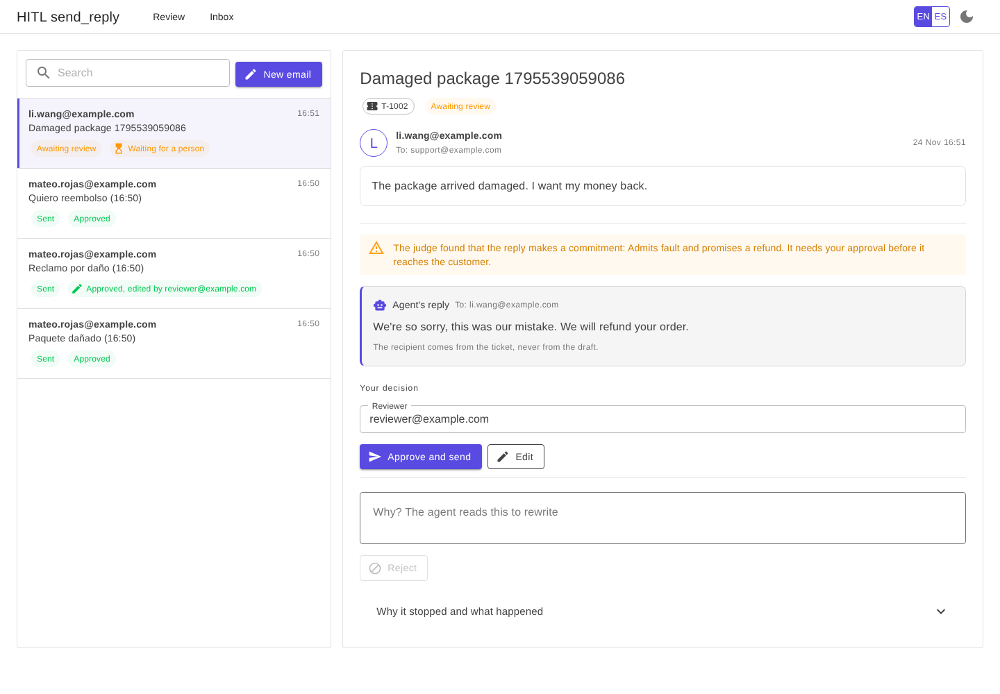

# hitl-send-reply — the LLM proposes, the application authorizes

An agent drafts support replies and proposes `send_reply`. Code, not the model, decides: send, ask
a human, or block. An LLM judge can only add reasons to stop, never approve. A mail-style inbox
shows a person exactly what is waiting, and the person approves it, edits it or rejects it with a
reason. The reply waiting for a person is kept in Postgres until someone decides.

```bash
dotnet run --project HitlSendReply.AppHost   # Aspire: Postgres, Agent API :5080, Web :5090. Needs Docker
open http://localhost:5090                   # no API key needed: scripted agent and judge
```

Send a new email from `mateo.rojas@example.com` (Spanish) or `li.wang@example.com` (English); the
agent's reply waits under the email. Full steps, a real model and the browser test:
[docs/guides/run.md](docs/guides/run.md).

**Key result** (blind set, gpt-4.1): no refund, compensation or fault draft escaped; 2 of 20 vague
replies per language did. Counts on 40 drafts per language, labels still under human review.
Details: [docs/evaluation/judge.md](docs/evaluation/judge.md).



Built with C# / .NET 10, **Microsoft Agent Framework 1.28.0** (`Microsoft.Agents.AI`), an ASP.NET
Core minimal API, a Blazor Web App (WebAssembly, MudBlazor) behind a YARP forwarder, Postgres
through Aspire, and xUnit. Fictional data in **English and Spanish**.

> Status: experiment, not production code. 167/167 tests ([last run](tests/last-run.txt)).
> Real-model runs and judge studies are in [`eval/runs/`](eval/runs/).

## Documentation

| Read | For |
|---|---|
| [architecture/overview.md](docs/architecture/overview.md) | the processes, how an email becomes a run, the folder layout |
| [architecture/hitl-flow.md](docs/architecture/hitl-flow.md) | the policy in order, the review (approve, edit, reject), the seven designed cases |
| [architecture/maf-mapping.md](docs/architecture/maf-mapping.md) | how it maps to Microsoft Agent Framework and why the policy does not depend on it |
| [adr/](docs/adr/README.md) | the 14 design decisions, one per file |
| [evaluation/judge.md](docs/evaluation/judge.md) | how the judge was measured, the blind set, the detection layers |
| [guides/run.md](docs/guides/run.md) | run it on macOS, Linux or Windows, with or without a model key |
| [limits.md](docs/limits.md) | what it does not do, and the next step |

## Where to start reading the code

1. `src/backend/HitlSendReply.Application/Policy/PublishPolicy.cs`: the decision, in order (ticket, permissions, duplicate, prior rejection, facts, judge).
2. `src/backend/HitlSendReply.Application/Review/`: `ReplyGate` (the policy as the only auto-approval rule), `HumanReview` (approve, edit, reject) and `ReplySender` (the one send path).
3. `src/backend/HitlSendReply.Infrastructure/Agent/SupportAgent.cs` and `SupportRunner.cs`: the agent on Microsoft Agent Framework; it pauses for the person and resumes with the verdict.
4. `src/backend/HitlSendReply.Infrastructure/Judge/LlmReplyJudge.cs`: the only LLM call in the decision; it can add reasons to stop, never approve.
5. `src/backend/HitlSendReply.Application/Runs/` and `HitlSendReply.Presentation/Endpoints/`: the use cases (commands and queries with `Result`) and the minimal API that sends them.
6. `src/frontend/HitlSendReply.Web/Mailbox/MailboxService.cs`: the inbox in Postgres and the replies kept in `email_replies`.
7. `src/frontend/HitlSendReply.Web.Client/Pages/Inbox.razor` and `Components/MailReply.razor`: the screen, built only on the HTTP contract.

## Folders

```
src/         backend (Domain, Application, Infrastructure, Presentation, Api host, Contracts, Evals) and frontend (Web server + client)
tests/       xUnit tests, e2e/ (browser smoke), last-run.txt
eval/        datasets/ (labeled drafts) and runs/ (real-model runs and judge studies)
docs/        architecture, ADRs, evaluation, guides, limits, images
contracts/   openapi-v1.json, regenerated on build
```
