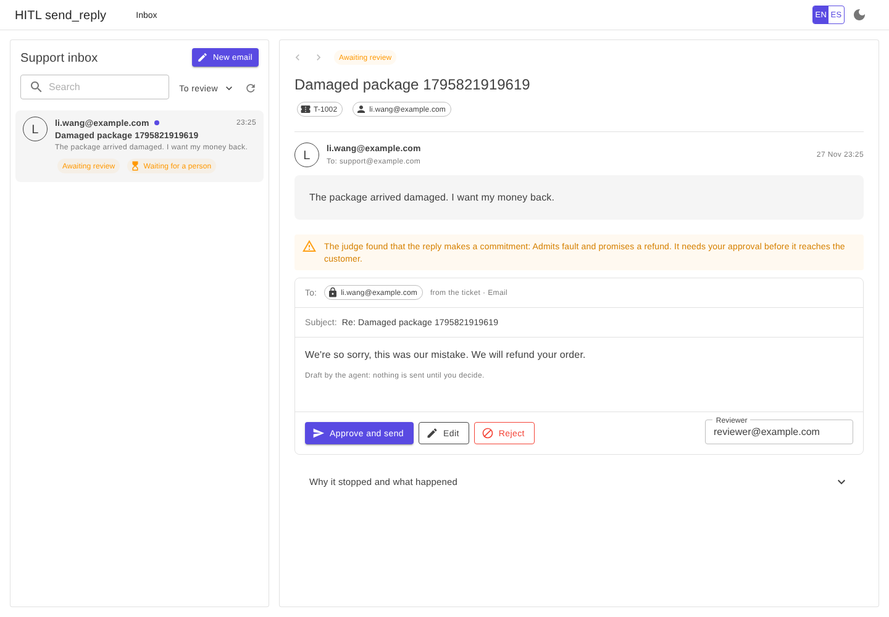

# Architecture overview

Three processes plus Postgres, started by Aspire (`HitlSendReply.AppHost`), one direction of dependency:

```
Browser (Blazor WebAssembly)            knows only the HTTP contract (Contracts)
   │  /api/...  same origin
   ▼
Web server (HitlSendReply.Web)          serves the client; YARP forwards /api to "https+http://api" ── the future BFF:
   │  /api/...                          the access token is added here, never in the browser
   ▼
Agent API (HitlSendReply.Api)           runs, reviews, catalog; contract in contracts/openapi-v1.json
   │  in process
   ▼
The system (HitlSendReply)              agent (MAF), publish policy, judge
```

Inside one run (detail in [hitl-flow.md](hitl-flow.md)):

```
customer message ──► Agent (LLM) ──► send_reply(ticketId, text)
                                         │  every call pauses (tool requires approval)
                                         ▼
                         Publish policy (application code), in order:
                           1. ticket exists, open          ── no ──► BLOCK (no human)
                           2. agent may reply on channel   ── no ──► BLOCK
                           3. same text already sent?      ── yes ─► BLOCK
                              same text a reviewer rejected? ── yes ─► BLOCK
                              any earlier rejection on ticket? ── yes ─► HUMAN
                           4. every date / amount / order id / status
                              in the text matches the record ── no ─► HUMAN
                           5. LLM judge: commitment, fault, legal,
                              ambiguity, unsure, error, timeout ──► HUMAN
                           all pass ─────────────────────────────► AUTO-SEND
                                         │
            HUMAN sees exact text + recipient + channel; approves once, or rejects with a reason
                                         │  (reason goes back to the agent, which may rewrite;
                                         │   a rewrite is a new call and runs the whole policy again)
                                         ▼
               send_reply: recipient & channel from the ticket, idempotency key,
               refuses any text not authorized byte-for-byte, writes the audit log
```

## How the work arrives

The inbox simulates an email provider. A person writes an email as a customer would
(From, a fixed To, Subject, Message), and the Web server does what an inbound-email webhook
integration does:

```
New email (MudDialog) ─► Web server: save InboundEmail in Postgres (status Received)
                              │
                              ▼  IInboundEmailNotifier
                         now:   POST /api/inbound-emails  { emailId, from, subject, body, receivedAt }
                         later: publish to a queue; its consumer sends the same ReceiveInboundEmailCommand
                              │
                              ▼  Agent API
                         match the ticket (sender address, else "T-1002" in the subject)
                         register a run and answer 202 at once; the agent drafts in the background
                         (run status Starting ─► policy ─► auto-send / human / block, or Failed)
                              │
                              ▼
Inbox, like a mail client: the list on the left, the open email on the right and, under it,
the agent's reply. When the policy sends it to a person, the reply is kept in email_replies
(Pending) until the person approves, edits or rejects it.
```

- **Save first, then notify.** If the Agent API cannot be reached, the email stays in the inbox as
  `NotifyFailed` with the error, and Retry hands it over again. It is never lost.
- **The webhook does not wait for the model.** It answers 202 as soon as the run is registered,
  the way inbound-email providers expect, so a slow model cannot time the call out. If starting
  fails (the model is down), the run is `Failed` with the reason and the row shows it.
- **Idempotent by email id.** A provider (or a queue) that delivers twice starts one run.
- **The reply goes to the ticket, not to the email.** A forged From with a ticket id in the
  subject starts a run on that ticket, and the draft is still addressed to the ticket's customer
  (`A_forged_sender_cannot_change_who_receives_the_reply`).
- **Without a model key**, the designed scenario for the matched ticket plays the agent, so the
  whole flow works offline. With a key, the real agent and judge answer.
- **The reply waiting for a person is kept in Postgres.** `email_replies` holds one row per review
  the policy asked for: the agent's draft, the status (`Pending`, `Approved`, `Rejected`), who
  decided, the reason, when, the text that reached the customer and whether the person edited it.
  A rejection makes the agent rewrite, and the rewrite is a new row. Only a pending row takes a
  decision, so the first one is the one kept. A background service (`PendingReplyTracker`) reads
  the runs in progress every 2 seconds, so a reply is stored even when nobody has the inbox open.
- **Rows follow the run.** While a row is in progress the page reloads every 2 seconds (no
  SignalR needed). The API keeps runs in memory: after it restarts, older rows keep their last
  status and say why.

Because the webhook answers at once, the Web server gives it 5 seconds and one retry: when the
API is down the email shows `NotifyFailed` after about 11 seconds. The background start lives in
the API process; a queue is the next step when runs must survive a restart, and only
`IInboundEmailNotifier` and the consumer change.



## Layout

```
contracts/openapi-v1.json         the HTTP contract, regenerated on build (language-neutral)
src/backend/HitlSendReply.Domain/          no packages: Result/Error, Tickets/ (ticket, order, idempotency key,
                                           permissions), Policy/ (decisions, FactChecker), Judge/ (signal), Review/ (verdict)
src/backend/HitlSendReply.Application/     no framework or model: Abstractions/ (ports: stores, outbox, audit, judge,
                                           agent, sessions), Policy/ (PublishPolicy), Review/ (gate, human review,
                                           the one send path, ledger), Runs/ and Tickets/ (commands, queries, handlers,
                                           validators, errors), Messaging/ and Behaviors/ (handler interfaces, decorators)
src/backend/HitlSendReply.Infrastructure/  the adapters: Agent/ (MAF agent, tools, resumable runner), Judge/ (LLM judges),
                                           Llm/ (model settings), InMemory/ (stores, sample tickets), Scripted/ (no-key demo),
                                           Pipeline (wires one run), RunSessionFactory
src/backend/HitlSendReply.Presentation/    minimal API: Endpoints/ (one IEndpoint per area), Results/ (Result → ProblemDetails)
src/backend/HitlSendReply.Api/             the host: Program.cs composes the layers and generates the OpenAPI document
src/backend/HitlSendReply.Contracts/       request and response records; references nothing
src/backend/HitlSendReply.Evals/           judge measurement over eval/datasets/
src/frontend/HitlSendReply.Web/        serves the client, forwards /api with YARP (future BFF)
  Mailbox/      simulated inbox: InboundEmail, EmailReply, MailboxDbContext + migrations, webhook notifier,
                PendingReplyTracker, endpoints
src/frontend/HitlSendReply.Web.Client/ the screens: Pages/Inbox (the mail-style inbox), Components/, Api/, Mailbox/, Localization/
tests/HitlSendReply.Tests/        168 tests, one folder per area; Support/ holds the seven designed scenarios (they run in EN and ES;
                                  Mailbox/ runs against Postgres in Testcontainers; skipped, with the reason, without Docker)
HitlSendReply.AppHost/            Aspire: postgres (database "mailbox"), api, web
HitlSendReply.ServiceDefaults/    telemetry, /health and /alive, service discovery, resilience
tests/e2e/smoke.mjs               browser smoke test (Playwright), saves docs/images/
tests/last-run.txt                the last full test run
eval/datasets/                    labeled drafts: drafts.<lang> (development) and blind.<lang> (never used to tune)
eval/runs/                        real-model runs and judge studies, each with its README
docs/                             architecture, ADRs, evaluation, guides, limits; images/ for screenshots
```
